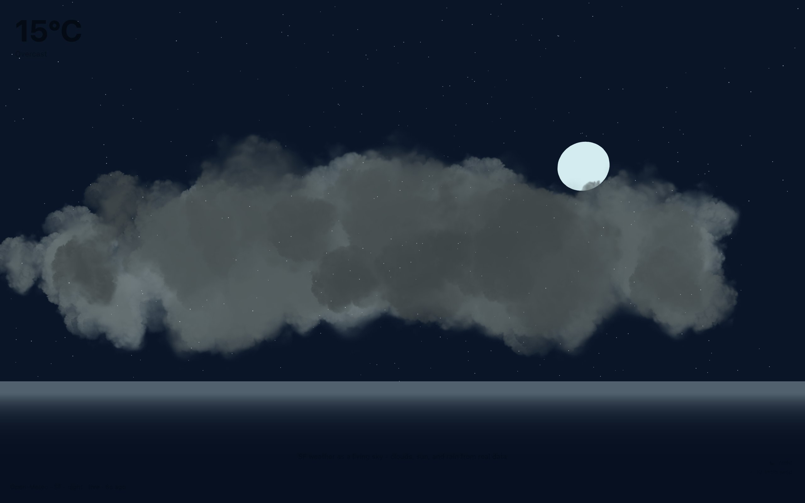
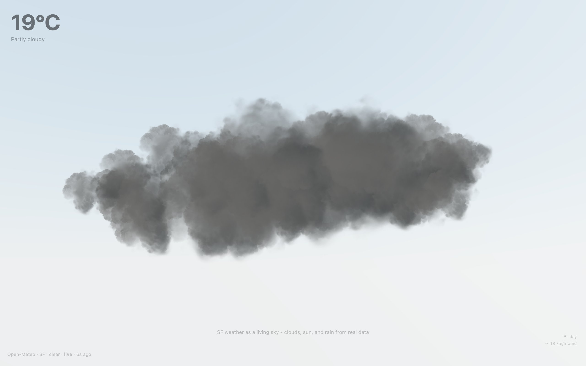

<div align="center">

<h1>Atmos</h1>

<p><b>San Francisco's sky, live, in 3D.</b></p>

<p><i>Look up from your desk at the weather outside: real cloud cover, real wind, day or night, rain when it rains.</i></p>

<h6>


</h6>

<a href="https://atmos.parthchandak.info"><b>Live demo</b></a> ·
<a href="#how-it-works"><b>How it works</b></a> ·
<a href="#run-it"><b>Run it</b></a>

<br><br>

<a href="https://atmos.parthchandak.info"></a>

<sub>Live capture, 22 October 2026, early evening in San Francisco. Real data: 15 °C, overcast, 100 % cloud cover.</sub>

</div>

<br>

A single React Three Fiber scene that redraws itself from San Francisco's current conditions.
Every 60 seconds it reads the [Open-Meteo](https://open-meteo.com) forecast for 37.77° N,
122.42° W and decides how many clouds to draw, how fast they drift, whether it is day or night,
and whether rain, fog or lightning should appear. No API key is needed.

## How it works

| Open-Meteo field | Drives |
|---|---|
| `is_day` | Day: drei `Sky` dome with a sun placed by San Francisco's local time (from `utc_offset_seconds`), plus a directional light. Night: 4,000 stars, a moon and light overlay text |
| `cloud_cover` | Number of volumetric clouds (0 to 5) and how opaque they are |
| `wind_speed_10m` | How fast the cloud bank drifts sideways, and the slant of falling rain |
| `weather_code` | Scene state: clear, mainly clear, partly cloudy (dimmer sun), overcast (dimmer still), fog, 3,500 rain particles for drizzle, rain and showers, flickering lightning for thunderstorms |
| `relative_humidity_2m` | Fog distance once humidity is above 75 % |
| `temperature_2m` | The big number top-left, and haze (turbidity) in the daytime sky |

Tap anywhere for a panel with wind, humidity, cloud cover and conditions; it fades after three
seconds. If the API fails the page shows the last reading saved in `localStorage`, then built-in
defaults, and the stamp in the bottom-left says `cached` or `fallback` instead of `live`. With
`prefers-reduced-motion` the clouds and rain hold still and the stars thin out.

<div align="center">



<sub>The daytime scene. Demo data (19 °C, partly cloudy, 60 % cover) injected into the live page.</sub>

</div>

## Run it

```bash
git clone https://github.com/parthchandak02/atmos.git
cd atmos
npm install
npm run dev      # local dev server
npm run build    # static site in dist/
```

The live version runs on Cloudflare Pages.

<details>
<summary><b>Project layout</b></summary>

```
src/App.tsx                     Canvas, camera and the DOM overlays
src/components/Atmosphere.tsx   Sky, stars, moon, clouds, fog and lightning
src/components/RainParticles.tsx  Rain as a point cloud
src/hooks/useWeather.ts         60-second poll, localStorage cache, fallback
src/lib/weather.ts              API URL, weather-code categories and data-to-scene mappings
brief.md                        The original creative brief and encoding contract
```

</details>

<br>

<div align="center">
<sub>Built with React Three Fiber, drei, Three.js and Vite. Data from Open-Meteo.</sub>
</div>
